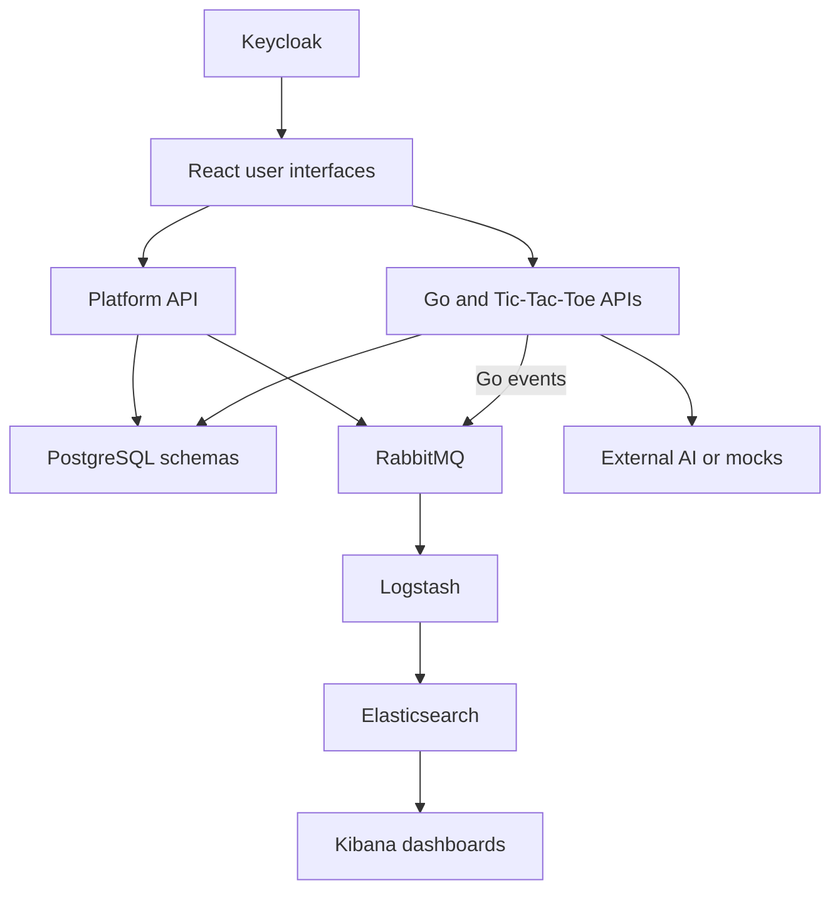

# FourteenGames

A university team project combining a browser-based board-game platform, **Go**, **Tic-Tac-Toe**, infrastructure and event-driven analytics in one source repository.

React and TypeScript provide the user interfaces. Java 21 / Spring Boot 3.5.7 services implement the platform and the two games, with PostgreSQL persistence and Keycloak authentication. RabbitMQ connects platform/game events to analytics built with Logstash, Elasticsearch, Kibana and Python.

This is an educational portfolio snapshot, not a production release. See [validation and known limitations](docs/REVIEW.md) before running it.

## Components

| Directory | Contents |
| --- | --- |
| [platform/platform-frontend](platform/platform-frontend) | React 19, TypeScript, Vite, MUI, TanStack Query and Zustand; catalogue, profiles, friends, lobbies, owned games and achievements |
| [platform/platform-backend](platform/platform-backend) | Spring Boot REST API, domain/application/infrastructure layers, JPA, OAuth2 resource server and RabbitMQ publishers/consumers |
| [games/go](games/go) | Separate React frontend and Spring Boot backend; variable board sizes, stone capture, scoring, turn passing, achievements and AI-service integration |
| [games/tic-tac-toe](games/tic-tac-toe) | Separate React frontend and Spring Boot backend; match state, moves and an AI-service integration |
| [infrastructure](infrastructure) | Docker Compose, PostgreSQL schema initialization, sanitized Keycloak realm templates and mock AI servers |
| [platform-analytics](platform-analytics) | RabbitMQ / Logstash ingestion, Elasticsearch templates/transforms, Kibana dashboard exports and Python setup/data-generation scripts |

## Architecture



Arrows describe code-level dependencies, not proof of a currently running deployment. The platform and Go publish events; the supplied Tic-Tac-Toe backend does not declare Spring AMQP. The analytics stack has its own RabbitMQ configuration, so sharing a broker requires configuration alignment (see the review).

## My contribution

I contributed to this team project as **Said Khalaf**, with a focus on the analytics subsystem and its Spring Boot integration:

- Defined analytics event models for platform and game activity.
- Configured the platform backend's RabbitMQ analytics pipeline and refined AMQP error handling.
- Built the analytics subsystem with Python setup/data-generation scripts, Logstash ingestion, Elasticsearch transforms and Kibana dashboards for revenue, retention/engagement and game performance.

The full game/platform implementation was team work. See [AUTHORS.md](AUTHORS.md) for attribution. The separate [analytics repository](https://github.com/Saidkhalaf/GamesPlatform-analytics) remains available.

## Local development

Requirements: **JDK 21**, Node.js compatible with Vite 7 (Node 22.12+ recommended for this snapshot), Python 3 and Docker Compose. Use the committed Gradle wrappers and npm lockfiles.

1. Start only the local support services from the repository root:

   ```bash
   docker compose -f infrastructure/docker-compose.yaml up -d app_postgres idp_mysql idp_keycloak app_rabbitmq
   ```

2. Open Keycloak at `http://localhost:8180`. Realm templates contain client configuration but no exported users or client secrets. Create your own local users and any required confidential-client secrets. The Compose files contain local demo passwords; do not expose these services publicly.
3. In separate terminals, start each backend from its directory:

   ```bash
   # platform/platform-backend, games/go/go-backend,
   # games/tic-tac-toe/tic-tac-toe-backend
   ./gradlew bootRun
   # Windows: .\gradlew.bat bootRun
   ```

4. In each frontend directory, run `npm ci` followed by `npm run dev`. The platform uses port 5173, Tic-Tac-Toe 5174 and Go 5175. Backends use 8070, 8081 and 8082 respectively.
5. AI play requires the external AI endpoints configured in application.properties or the mock servers under `infrastructure/Test-ai-server`. The full external AI implementation is not included.

The infrastructure also references a course-provided Chess container. It is an external integration, not a third included game implementation, and is not needed for the support-services command above.

### Analytics

See [the analytics README](platform-analytics/README.md), [event specification](platform-analytics/docs/EVENT_SPECIFICATION.md) and [dashboard PDFs](platform-analytics/docs/dashboards). Dashboard sample figures are generated demonstration data, not real users or commercial results.

Copy `platform-analytics/.env.example` to `.env` in that directory for the standalone demo. Its RabbitMQ ports conflict with the platform infrastructure if both standalone stacks run unchanged. Do not start both brokers on the same ports. The inherited startup scripts also reset volumes; read them before use.

## Verification

- All three frontend production builds passed during this review.
- Platform frontend: **43 tests passed**. Go frontend: **12 tests passed**.
- Analytics: **9 existing unit tests passed**, but these mostly check fixtures/sample structures rather than real processing.
- Java backend tests and Docker integration were **not executed** in the review environment. No end-to-end deployment success is claimed.

See [docs/REVIEW.md](docs/REVIEW.md) for commands, findings and limitations.

## Publication cleanup

This consolidated snapshot excludes nested Git histories, dependency/build caches, persisted databases, RabbitMQ state, generated private keys, copied HTTP request collections and the course assignment PDF. Keycloak users and secrets were removed from the realm exports. Original component CI files and source organization remain in place; there is no claim that their GitLab pipelines run automatically on GitHub.
